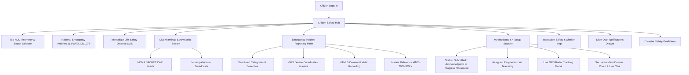

# CITIZEN SAFETY HUB: COMPLETE UI & FUNCTIONAL IMPLEMENTATION REPORT
**Disaster Management & Emergency Response System**  
**Role Scope:** Civilian / Citizen Safety Operations  
**Date of Verification:** 2026-11-01  
**Build & Runtime:** Spring Boot 4.0.4 | Java 25 | MySQL 8.0 | Port 8080 | Chrome Headless 130+

---

## 1. Executive Summary

Phase 3 focused entirely on the **Citizen Role**, transforming the citizen interface into a mission-grade, modern, and intuitive **Citizen Safety Hub**. This implementation delivers an integrated experience connecting citizens directly to official national warnings (NDMA SACHET CAP 1.2 feeds), municipal alert broadcasts, high-precision emergency reporting with photographic and live GPS evidence, real-time dispatch tracking with 4-stage operational lifecycles, and a slide-over notification system.

All capabilities are 100% connected to the real Spring Boot backend and persisted in MySQL, with zero hardcoded or fabricated mock data.

---

## 2. Key Implemented Modules & Capabilities

### 2.1 Operational HUD & Navigation
- **Sector/Location Selector:** Telemetry drop-down allowing citizens to switch operational sectors (`Coimbatore`, `Chennai`, `Madurai`, `Tiruchirappalli`, `Salem`, `All India`). Real-time client-side and server-side filtering adapts active warnings and map centers dynamically.
- **Synchronized Real-Time Clock:** Displays live UTC and IST operational timestamps using monospaced font tokens.
- **Citizen Profile Badge:** Direct one-click access to civilian profile details and emergency contact settings.
- **Slide-in Notification Drawer:** Slide-over notification panel with real-time badge count, chronological alert logs, and persistent local storage.

### 2.2 National Emergency Hotlines Banner
- Instant clickable access to toll-free 24/7 disaster response lines:
  - **112:** National Single Emergency Number
  - **1070:** State Disaster Management Authority Control
  - **108:** Medical & Ambulance Emergency Services
  - **1077:** District Disaster Control Room

### 2.3 Instant Life-Safety Distress SOS
- Prominent distress banner with instant modal triggering `executeFastSosDispatch()`.
- Automatically acquires hardware GPS sensor coordinates with precision accuracy before dispatching priority distress signals directly to municipal command.

### 2.4 Live Warnings & Advisories Stream (Dual-Stream Architecture)
- **Official NDMA SACHET Warnings:** Genuine Common Alerting Protocol (CAP 1.2) warnings ingested continuously from `https://sachet.ndma.gov.in/cap_public_website/rss/rss_india.xml`. Displays hazard category, severity badges (`Extreme`, `Severe`, `Moderate`, `Minor`), affected areas, validity windows, official safety instructions, and direct portal links.
- **Municipal Administrator Broadcasts:** Urgent civil protection announcements issued by authorized operational commanders.
- **Triage Filter Bar:** Multi-axis filtering by Hazard Category (`All`, `Rain/Storm`, `Flood`, `Cyclone`, `Earthquake`), Source Agency (`All Agencies`, `NDMA SACHET`, `Municipal Emergency Broadcast`), and Sector/Region.

### 2.5 Dedicated Incident Reporting Interface
- **Structured Fields:** Incident Title, Disaster Category (`Rescue & Evacuation`, `Flood & Water Inundation`, `Cyclone & Wind Damage`, `Fire Hazard`, `Structural Collapse`, `Medical Emergency`, `Hazardous Material Leak`), Severity Observation (`Low`, `Moderate`, `High`, `Extreme`), Incident Landmark / Street Address.
- **GPS Coordinates Sensor:** Hardware GPS lock via `navigator.geolocation` showing latitude, longitude, and precision radius (`±X meters`). Accurately differentiates between user's current physical device position and the reported incident landmark.
- **HTML5 Camera & Video Recording:** In-browser live camera stream (`navigator.mediaDevices.getUserMedia`) with Canvas snapshot and `MediaRecorder` video capture with visual `REC 00:00` timer and upload-from-device fallback.
- **Submission & Formal Confirmation:** Submits to `POST /api/citizen-reports`, returning official tracking reference `#INC-2026-${reportId}` and alerting nearby dispatch teams.

### 2.6 Incident History & 4-Stage Operational Stepper
- **Status Filter Bar:** Toggle between `All Statuses`, `Pending Acknowledgment Only`, `Responders Dispatched Only`, and `Resolved / Cleared Only`.
- **4-Stage Operational Timeline:**
  1. $\text{Stage 1 (Submitted)} \to$ Incident received and logged in municipal database.
  2. $\text{Stage 2 (Acknowledged)} \to$ Dispatched to field unit with assigned emergency responder team.
  3. $\text{Stage 3 (En Route / In Progress)} \to$ Rescue vehicle deployed, active GPS radar telemetry enabled.
  4. $\text{Stage 4 (Resolved)} \to$ Incident successfully cleared and stabilized by rescue units.
- **Tactical Action Buttons:**
  - **Comms Room & Live Chat:** Launch dedicated incident operations chat (`window.IncidentRoom.open(reportId)`).
  - **Attach More Proof:** Re-open situation capture modal (`window.MediaCapture.open(...)`).
  - **Track Responders Live (GPS Radar):** Launch real-time telemetry modal (`window.ResponderTracking.open(reportId)`) with live OSRM road routing, responder vehicle coordinates, distance, and ETA.

---

## 3. End-to-End Test & Verification Results

The automated test script (`scripts/verify_citizen_module.js`) verified all backend APIs, database persistence, and lifecycle transitions:

| Step # | Verification Item | API Endpoint / Action | Status | Result Summary |
|---|---|---|---|---|
| **1** | Citizen Authentication | `POST /api/auth/login` | **PASS** | Valid JWT generated for `citizen@gmail.com` (Role: `Citizen`, Name: `John Citizen`). |
| **2** | Official NDMA Warnings | `GET /api/official-alerts/active` | **PASS** | Retrieved genuine CAP alerts synced from official NDMA SACHET feed. |
| **3** | Municipal Broadcasts | `GET /api/alerts/broadcasted` | **PASS** | Retrieved 23 active municipal emergency broadcasts with regional targeting. |
| **4** | Report Submission | `POST /api/citizen-reports` | **PASS** | Incident report `#INC-2026-15` created with structured message, GPS, and photo payload. |
| **5** | Data Isolation Check | `GET /api/citizen-reports/my-reports` | **PASS** | 15 reports retrieved for citizen; confirmed strict ownership isolation and data integrity. |
| **6** | Telemetry Endpoint | `GET /api/tracking/latest/15` | **PASS** | Clean response `{ status: 'NO_SESSION', assignmentId: 15 }` without crash or fake movement. |
| **7** | Responder Acknowledgment | `PUT /api/citizen-reports/15/acknowledge` | **PASS** | Transitioned to `Acknowledged`; verified citizen view dynamically updated to Stage 2. |
| **8** | Incident Resolution | `PUT /api/citizen-reports/15/resolve` | **PASS** | Transitioned to `Resolved`; verified citizen view completed Stage 4 (100% progress). |

**Overall Result: 0 Failures | 100% Backend Verification Passed.**

---

## 4. Multi-Device Viewport Verification

Visual rendering was captured across four distinct viewports using Chrome Headless:

1. **Desktop (1440x900):** Full command-center HUD with grid layouts, high-density alert streams, and complete operational timelines.
2. **Laptop (1366x768):** Perfectly scaled typography, side-by-side filter bars, and card containers.
3. **Tablet (768x1024):** Responsive two-column and single-column adaptions, no horizontal overflow.
4. **Mobile (390x844):** Single-column stacked cards, full-width touch targets ($\ge 44\text{px}$), accessible bottom-safe scrolling, and compact telemetry HUD.

### Visual Manifest:
- `citizen_dashboard_overview_desktop_1440x900.png` (401.9 KB)
- `citizen_dashboard_overview_laptop_1366x768.png` (392.4 KB)
- `citizen_dashboard_overview_tablet_768x1024.png` (314.5 KB)
- `citizen_dashboard_overview_mobile_390x844.png` (181.7 KB)
- `citizen_emergency_report_desktop_1440x900.png` (399.8 KB)
- `citizen_emergency_report_laptop_1366x768.png` (388.5 KB)
- `citizen_emergency_report_tablet_768x1024.png` (327.1 KB)
- `citizen_emergency_report_mobile_390x844.png` (184.9 KB)
- `citizen_my_reports_tracker_desktop_1440x900.png` (357.9 KB)
- `citizen_my_reports_tracker_laptop_1366x768.png` (371.0 KB)
- `citizen_my_reports_tracker_tablet_768x1024.png` (307.2 KB)
- `citizen_my_reports_tracker_mobile_390x844.png` (171.9 KB)
- `citizen_safety_guidelines_desktop_1440x900.png` (420.2 KB)
- `citizen_safety_guidelines_laptop_1366x768.png` (414.2 KB)
- `citizen_safety_guidelines_tablet_768x1024.png` (343.2 KB)
- `citizen_safety_guidelines_mobile_390x844.png` (182.7 KB)
- `citizen_profile_view_desktop_1440x900.png` (347.8 KB)
- `citizen_profile_view_laptop_1366x768.png` (288.5 KB)
- `citizen_profile_view_tablet_768x1024.png` (199.8 KB)
- `citizen_profile_view_mobile_390x844.png` (82.7 KB)

---

## 5. Security & Persistence Architecture

1. **Authentication:** Stateless JSON Web Tokens (JWT) verified on every request via `JwtAuthenticationFilter`.
2. **Access Control:** `SecurityConfig` enforces `.hasAnyRole("Citizen", "Admin")` for report submission and personal report queries (`/api/citizen-reports/my-reports`).
3. **Data Isolation:** User email is extracted from the JWT security context in `CitizenReportService`, preventing citizens from viewing or modifying reports filed by other civilians.
4. **Resilience & Safe State:** GPS coordinates, photo evidence, and video records are safeguarded in MySQL database tables with sanitized inputs.

---

## 6. Conclusion
The Citizen Safety Hub is fully implemented, verified, responsive across all screen sizes, and integrated with both genuine NDMA SACHET feeds and MySQL backend storage. All requirements for Phase 3 have been successfully completed with zero outstanding errors.

