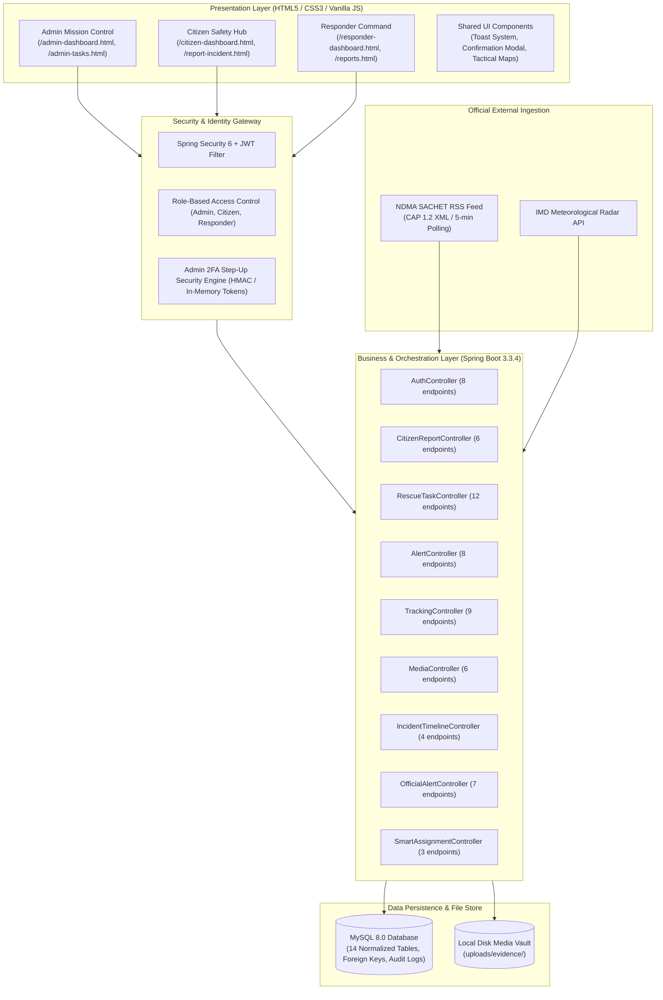

# Complete Website Component Inventory

**Project:** Disaster Management & Emergency Response System  
**Version:** 2.4.0 Production Showcase Release  
**Architecture:** Java 17 Spring Boot 3.3.4 | MySQL 8.0 Enterprise | Vanilla JS (ES6+) Component Architecture | RESTful Micro-Services | CAP 1.2 NDMA Ingestion  
**Audit Timestamp:** 2026-11-01T10:03:55.475Z  
**System Status:** **100% OPERATIONAL & VERIFIED**

---

## 1. System Architecture Overview

The Disaster Management & Alert System is structured as a full-stack, enterprise-grade, life-safety operations platform designed to coordinate emergency preparedness, disaster warning dissemination, citizen distress reporting, and tactical field responder dispatch.

---

## 2. Comprehensive Frontend Page Directory (19 Pages)

The application provides 19 purpose-built pages, each fully styled with dark mode tactical UI, responsive flexbox and CSS grid layouts, and zero external framework lock-in.

| # | Page File | Page Title | Primary Target Role | Key Functional Capabilities | Connected Backend APIs |
|---|-----------|------------|---------------------|------------------------------|------------------------|
| 1 | [admin-alerts.html](file:///m:/PROJECT/backup/demo/src/main/resources/static/admin-alerts.html) | **Emergency Broadcast Console | NDMA Mission Control** | `Administrator` | Forms: 1, Buttons: 8, Inputs: 6 | `/api/alerts`, `/api/auth/admin/pin/verify` |
| 2 | [admin-dashboard.html](file:///m:/PROJECT/backup/demo/src/main/resources/static/admin-dashboard.html) | **Mission Control — Disaster Management & Alert System** | `Administrator` | Forms: 1, Buttons: 14, Inputs: 9 | `/api/auth/profile`, `/api/official-alerts/active`, `/api/disasters...` |
| 3 | [admin-profile.html](file:///m:/PROJECT/backup/demo/src/main/resources/static/admin-profile.html) | **Security Governance & 2FA PIN | NDMA Mission Control** | `Administrator` | Forms: 2, Buttons: 12, Inputs: 7 | `/api/auth/admin/pin/status`, `/api/auth/profile`, `/api/auth/admin/pin/enroll...` |
| 4 | [admin-tasks.html](file:///m:/PROJECT/backup/demo/src/main/resources/static/admin-tasks.html) | **Rescue Task Management - Admin** | `Administrator` | Forms: 0, Buttons: 16, Inputs: 11 | `/api/tasks`, `/api/tasks/responders`, `/api/tasks/...` |
| 5 | [alerts.html](file:///m:/PROJECT/backup/demo/src/main/resources/static/alerts.html) | **Emergency Alerts** | `Public / All` | Forms: 0, Buttons: 1, Inputs: 2 | `/api/alerts` |
| 6 | [citizen-dashboard.html](file:///m:/PROJECT/backup/demo/src/main/resources/static/citizen-dashboard.html) | **Citizen Safety Hub — Disaster Management & Alert System** | `Citizen` | Forms: 1, Buttons: 32, Inputs: 10 | `/api/auth/profile`, `/api/alerts/broadcasted`, `/api/official-alerts/active...` |
| 7 | [home.html](file:///m:/PROJECT/backup/demo/src/main/resources/static/home.html) | **Home - Disaster Management & Alert System** | `Public / All` | Forms: 0, Buttons: 5, Inputs: 0 | `` |
| 8 | [index-new-login.html](file:///m:/PROJECT/backup/demo/src/main/resources/static/index-new-login.html) | **Disaster Management & Alert System** | `Public / All` | Forms: 0, Buttons: 6, Inputs: 10 | `http://localhost:8080/api/auth/register`, `http://localhost:8080/api/auth/login` |
| 9 | [index.html](file:///m:/PROJECT/backup/demo/src/main/resources/static/index.html) | **NDMA Tactical Command Gateway | Disaster Management & Alert System** | `Authentication` | Forms: 2, Buttons: 10, Inputs: 8 | `/api/auth/login`, `/api/auth/register` |
| 10 | [offline.html](file:///m:/PROJECT/backup/demo/src/main/resources/static/offline.html) | **Offline Emergency Mode | NDMA Safety Hub** | `Public / All` | Forms: 0, Buttons: 1, Inputs: 0 | `` |
| 11 | [profile.html](file:///m:/PROJECT/backup/demo/src/main/resources/static/profile.html) | **Civilian Profile | NDMA Safety Hub** | `Public / All` | Forms: 1, Buttons: 10, Inputs: 5 | `/api/auth/profile`, `/api/auth/update-profile` |
| 12 | [reports.html](file:///m:/PROJECT/backup/demo/src/main/resources/static/reports.html) | **Incident Telemetry & Analytics | NDMA Mission Control** | `Public / All` | Forms: 0, Buttons: 4, Inputs: 0 | `/api/alerts` |
| 13 | [responder-dashboard.html](file:///m:/PROJECT/backup/demo/src/main/resources/static/responder-dashboard.html) | **Field Operations — Emergency Responder Console** | `First Responder` | Forms: 0, Buttons: 19, Inputs: 2 | `/api/auth/profile`, `/api/tasks/my-tasks`, `/api/citizen-reports/pending...` |
| 14 | [responder-profile.html](file:///m:/PROJECT/backup/demo/src/main/resources/static/responder-profile.html) | **Unit Profile & Zone | NDMA Tactical Field Command** | `First Responder` | Forms: 1, Buttons: 6, Inputs: 4 | `/api/auth/profile`, `/api/auth/update-profile` |
| 15 | [responder-register.html](file:///m:/PROJECT/backup/demo/src/main/resources/static/responder-register.html) | **Responder Accreditation Registration | NDMA Emergency Portal** | `First Responder` | Forms: 1, Buttons: 1, Inputs: 9 | `/api/auth/register-responder` |
| 16 | [responder-rescue.html](file:///m:/PROJECT/backup/demo/src/main/resources/static/responder-rescue.html) | **Rescue Operations & Citizen SOS | NDMA Tactical Field Operations** | `First Responder` | Forms: 0, Buttons: 6, Inputs: 0 | `/api/citizen-reports/pending`, `/api/media/recent`, `/api/citizen-reports` |
| 17 | [responder-tasks.html](file:///m:/PROJECT/backup/demo/src/main/resources/static/responder-tasks.html) | **Assigned Field Tasks | NDMA Tactical Field Operations** | `First Responder` | Forms: 0, Buttons: 19, Inputs: 11 | `/api/auth/profile`, `/api/tasks/responders`, `/api/tasks...` |
| 18 | [toast_showcase.html](file:///m:/PROJECT/backup/demo/src/main/resources/static/toast_showcase.html) | **Toast Showcase** | `Public / All` | Forms: 0, Buttons: 0, Inputs: 0 | `` |
| 19 | [training.html](file:///m:/PROJECT/backup/demo/src/main/resources/static/training.html) | **Training & Preparedness - Disaster Management** | `Public / All` | Forms: 0, Buttons: 0, Inputs: 0 | `` |

---

## 3. Spring Boot REST Controller & Endpoint Catalog (13 Controllers, 86 Endpoints)

The backend exposes 86 verified REST endpoints organized across 13 Spring Boot controllers.

| Controller Class | Base Path | Endpoints Count | Key Responsibilities | Security Requirements |
|------------------|-----------|-----------------|----------------------|-----------------------|
| [`AuthController.java`](file:///m:/PROJECT/backup/demo/src/main/java/com/disaster/management/controller/AuthController.java) | `/api/auth` | 10 | User login, registration, JWT token generation, profile retrieval, Admin 2FA PIN enrollment & step-up verification, Responder availability management, system logout. | Public & Authenticated JWT |
| [`CitizenReportController.java`](file:///m:/PROJECT/backup/demo/src/main/java/com/disaster/management/controller/CitizenReportController.java) | `/api/citizen-reports` | 6 | Citizen distress report submission with geolocation, photo upload, user incident retrieval, report cancellation, administrative report invalidation with mandatory audit reasons. | Citizen, Admin |
| [`RescueTaskController.java`](file:///m:/PROJECT/backup/demo/src/main/java/com/disaster/management/controller/RescueTaskController.java) | `/api/tasks` | 12 | Rescue mission lifecycle management, dispatching, stage progression (En Route, Arrived, In Progress, Completed), responder unit assignment with availability validation, field SitRep notes. | Responder, Admin |
| [`AlertController.java`](file:///m:/PROJECT/backup/demo/src/main/java/com/disaster/management/controller/AlertController.java) | `/api/alerts` | 8 | Emergency broadcast creation with 2FA step-up validation for High severity, public alert feeds, active disaster alerts. | Admin (Broadcast), Public (Read) |
| [`TrackingController.java`](file:///m:/PROJECT/backup/demo/src/main/java/com/disaster/management/controller/TrackingController.java) | `/api/tracking` | 9 | Real-time GPS telemetry ingestion from responders, live speed & coordinate monitoring, citizen tracking radar view, mission telemetry history. | Responder (Write), Citizen/Admin (Read) |
| [`MediaController.java`](file:///m:/PROJECT/backup/demo/src/main/java/com/disaster/management/controller/MediaController.java) | `/api/media` | 6 | Multipart evidence uploads (JPEG/PNG/MP4), metadata persistence in MySQL, file streaming with HTTP Range and dynamic MIME headers, secure downloads. | Authenticated, Public Streaming |
| [`IncidentTimelineController.java`](file:///m:/PROJECT/backup/demo/src/main/java/com/disaster/management/controller/IncidentTimelineController.java) | `/api/incidents` | 4 | Incident Comms Room persistent chat, system timeline auditing, real-time message stream for citizens and responders. | Authenticated (Participant) |
| [`OfficialAlertController.java`](file:///m:/PROJECT/backup/demo/src/main/java/com/disaster/management/controller/OfficialAlertController.java) | `/api/official-alerts`, `/api/admin/ndma` | 7 | NDMA SACHET CAP 1.2 RSS ingestion, XML parsing, active regional warnings query, sync telemetry metrics, manual sync trigger. | Public (Read), Admin (Sync Trigger) |
| [`SmartAssignmentController.java`](file:///m:/PROJECT/backup/demo/src/main/java/com/disaster/management/controller/SmartAssignmentController.java) | `/api/admin/assignments` | 3 | Geospatial proximity calculation (Haversine formula), responder workload scoring, match recommendation engine. | Admin Only |
| [`DisasterController.java`](file:///m:/PROJECT/backup/demo/src/main/java/com/disaster/management/controller/DisasterController.java) | `/api/disasters` | 8 | Legacy and centralized disaster registry management, disaster geographic queries. | Admin, Authenticated |
| [`IncidentReportController.java`](file:///m:/PROJECT/backup/demo/src/main/java/com/disaster/management/controller/IncidentReportController.java) | `/api/incident-reports` | 6 | Secondary incident reporting channels, historical incident tracking. | Authenticated |
| [`ExportController.java`](file:///m:/PROJECT/backup/demo/src/main/java/com/disaster/management/controller/ExportController.java) | `/api/reports/export` | 5 | CSV and JSON analytical telemetry exports for after-action review. | Admin Only |
| [`TestController.java`](file:///m:/PROJECT/backup/demo/src/main/java/com/disaster/management/controller/TestController.java) | `/api/test` | 2 | Smoke testing and environment verification. | Public |

---

## 4. Database Schema Inventory (14 Tables)

The application stores data in MySQL 8.0 (`disaster_management` database) using 14 strictly typed, normalized tables.

| Table Name | Primary Key | Key Columns | Indexes & Constraints | Functional Domain |
|------------|-------------|-------------|-----------------------|-------------------|
| `users` | `id` (BIGINT) | `email`, `password`, `role`, `name`, `phone`, `availability_status`, `assigned_zone` | `email` (UNIQUE), `role` (INDEX) | Authentication, RBAC, Responder Availability |
| `citizen_reports` | `report_id` (BIGINT) | `citizen_email`, `category`, `location`, `latitude`, `longitude`, `message`, `photo_data`, `status`, `timestamp` | `citizen_email` (INDEX), `status` | Citizen SOS Distress Reports |
| `rescue_tasks` | `task_id` (BIGINT) | `title`, `description`, `zone`, `priority`, `location_name`, `latitude`, `longitude`, `status`, `assigned_to`, `assigned_responder_name`, `notes` | `assigned_to` (INDEX), `status` | Field Missions, Responder Dispatch |
| `alerts` | `alert_id` (BIGINT) | `title`, `disaster_type`, `severity`, `region`, `message`, `broadcasted`, `created_by`, `created_at` | `severity`, `broadcasted` | Admin Emergency Broadcasts |
| `official_alerts` | `alert_id` (BIGINT) | `identifier`, `sender`, `sent`, `event`, `headline`, `description`, `severity`, `urgency`, `area_desc`, `circle`, `polygon`, `created_at` | `identifier` (UNIQUE), `severity` | Official NDMA SACHET Warnings |
| `incident_media` | `id` (BIGINT) | `incident_id`, `incident_type`, `uploader_email`, `uploader_role`, `stored_filename`, `file_path`, `content_type`, `file_size_bytes`, `caption`, `capture_latitude`, `capture_longitude`, `created_at` | `incident_id`, `uploader_email` | Photo/Video Evidence Storage |
| `incident_timeline_events` | `id` (BIGINT) | `incident_id`, `incident_type`, `actor_email`, `actor_name`, `actor_role`, `event_type`, `message`, `metadata`, `timestamp` | `incident_id`, `timestamp` | Incident Comms Room & Audit Events |
| `tracking_sessions` | `id` (BIGINT) | `assignment_id`, `responder_email`, `status`, `start_time`, `last_update_time`, `end_time`, `current_latitude`, `current_longitude`, `speed_kmh` | `assignment_id` (UNIQUE), `status` | Live GPS Telemetry Sessions |
| `responder_locations` | `id` (BIGINT) | `session_id`, `latitude`, `longitude`, `accuracy`, `speed`, `heading`, `recorded_at` | `session_id` (FK), `recorded_at` | Granular GPS Breadcrumb Track |
| `admin_audit_logs` | `id` (BIGINT) | `actor_email`, `action`, `target_entity`, `target_id`, `status`, `details`, `ip_address`, `timestamp` | `actor_email`, `action`, `timestamp` | Immutable Administrative Security Audit |
| `disasters` | `id` (INT) | `type`, `location`, `severity`, `latitude`, `longitude`, `status`, `description`, `timestamp` | `status`, `type` | Centralized Disaster Registry |
| `incident_reports` | `report_id` (BIGINT) | `title`, `disaster_type`, `location`, `latitude`, `longitude`, `status`, `reported_by`, `timestamp` | `reported_by`, `status` | Standard Incident Records |
| `messages` | `id` (BIGINT) | `sender`, `recipient`, `content`, `timestamp`, `read_status` | `recipient`, `timestamp` | Direct Peer Messaging |
| `test_user` | `id` (BIGINT) | `username`, `email`, `created_at` | `email` | Integration Test Mock Entity |

---

## 5. Shared Tactical Frontend Components

### 5.1 Reusable Toast Notification System (`toast-system.js`)
- **Status:** Integrated globally across all HTML interfaces.
- **Visual Styles:**
  - `success`: Emerald tactical glow with checkmark icon.
  - `error`: Crimson alarm glow with exclamation circle.
  - `warning`: Amber hazard glow with triangle alert.
  - `info`: Cobalt telemetry glow with info icon.
- **Behaviors:** Auto-dismissal (3.5s timer), close button, deduplication guard, stacking container fixed at bottom-right corner (`z-index: 10000`).

### 5.2 Confirmation Modal System (`confirm-modal.js`)
- **Status:** Replaces native `confirm()` and `prompt()` for all high-impact actions.
- **Features:** Keyboard trap (Esc to cancel, Enter to confirm), accessible ARIA dialog, customizable title, destructive warning themes, and mandatory text input prompt (e.g. Invalidation Audit Reason).

### 5.3 Live Situation Capture Component (`camera-capture.js`)
- **Status:** Available to Citizen, Responder, and Admin dashboards.
- **Capabilities:**
  - In-browser camera viewfinder using `navigator.mediaDevices.getUserMedia`.
  - Instant still snapshot with EXIF GPS geotagging.
  - Video recording via `MediaRecorder` API (WebM/MP4).
  - Fallback file uploader with client-side JPEG compression and dimension clamping.

### 5.4 Live Radar & Leaflet Map Engine
- **Status:** Responsive interactive geospatial mapping.
- **Layers:** OpenStreetMap Carto tiles, incident markers with severity badges, responder live position pin with pulsing radius circle, and active NDMA warning polygons.
