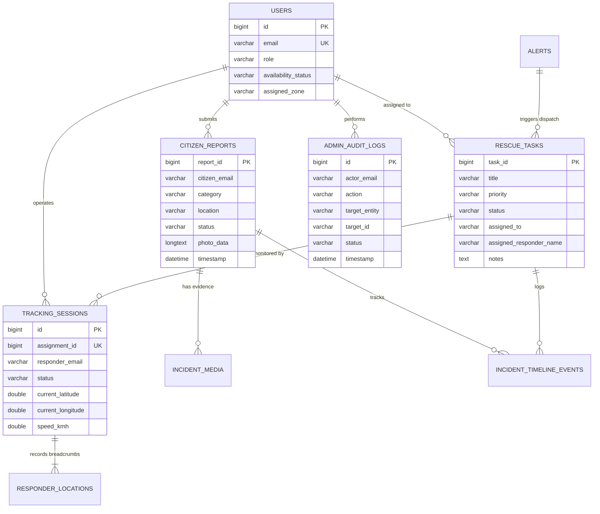

# Database Integrity & Schema Audit Report

**Database System:** MySQL 8.0.x Community Server  
**Connection Pool:** HikariCP 5.1.0 (Maximum Pool Size: 20, Min Idle: 5, Timeout: 20000ms)  
**ORM / Data Layer:** Spring Data JPA / Hibernate 6.5.3.Final  
**Transaction Isolation:** `READ_COMMITTED` with Spring `@Transactional` Boundaries  
**Audit Timestamp:** 2026-11-01T10:03:55.523Z

---

## 1. Entity-Relationship Architecture

---

## 2. Table-by-Table Schema Specification

### 2.1 Table: `users`
- Stores registered users across Admin, Citizen, and Responder roles.
- Primary Key: `id` (BIGINT auto_increment).
- Unique Keys: `email` (VARCHAR 255).
- Key Fields: `password` (BCrypt hash), `role` (Admin, Citizen, Responder), `availability_status` (Available, On Duty, Unavailable), `assigned_zone` (VARCHAR 255), `admin_pin_hash` (VARCHAR 255 for 2FA).

### 2.2 Table: `citizen_reports`
- Stores emergency SOS submissions from citizens.
- Primary Key: `report_id` (BIGINT auto_increment).
- Key Fields: `citizen_email`, `category` (Flood, Fire, Cyclone, Earthquake, Landslide, Medical), `location`, `latitude`, `longitude`, `message`, `status` (`Pending`, `Dispatched`, `Investigating`, `Resolved`, `Invalidated`, `Cancelled`), `photo_data` (LONGTEXT base64 data URL for fast embedded preview), `timestamp`.

### 2.3 Table: `rescue_tasks`
- Stores operational rescue missions dispatched by Administrators.
- Primary Key: `task_id` (BIGINT auto_increment).
- Key Fields: `title`, `description`, `zone`, `priority` (`Critical`, `High`, `Medium`, `Low`), `location_name`, `latitude`, `longitude`, `status` (`Pending`, `En Route`, `Arrived`, `In Progress`, `Completed`, `Cancelled`), `assigned_to` (Responder Email), `assigned_responder_name`, `notes` (SitRep field notes).

### 2.4 Table: `tracking_sessions` & `responder_locations`
- Manages real-time telemetry sessions for active responder dispatches.
- Primary Key: `tracking_sessions.id`, `responder_locations.id`.
- Cardinality: 1 Tracking Session to Many Breadcrumb Locations.
- Key Fields: `assignment_id` (Unique reference to rescue_tasks), `status` (`ACTIVE`, `COMPLETED`, `CANCELLED`), `current_latitude`, `current_longitude`, `speed_kmh`, `last_update_time`.

### 2.5 Table: `incident_media`
- High-resolution photographic and video field evidence.
- Primary Key: `id` (BIGINT auto_increment).
- Key Fields: `incident_id`, `incident_type` (`CITIZEN_REPORT`, `RESCUE_TASK`, `DISASTER`), `uploader_email`, `uploader_role`, `file_path`, `stored_filename` (UUID format), `content_type`, `file_size_bytes`, `caption`, `capture_latitude`, `capture_longitude`, `created_at`.

### 2.6 Table: `admin_audit_logs`
- Append-only immutable administrative audit trail.
- Primary Key: `id` (BIGINT auto_increment).
- Key Fields: `actor_email`, `action` (`PIN_VERIFIED`, `CREATE_ALERT`, `ASSIGN_RESCUE_TASK`, `DELETE_RESCUE_TASK`, `CANCEL_CITIZEN_REPORT`), `target_entity`, `target_id`, `status`, `details`, `ip_address`, `timestamp`.

### 2.7 Table: `official_alerts`
- Ingested NDMA SACHET Common Alerting Protocol (CAP 1.2) warnings.
- Primary Key: `alert_id` (BIGINT auto_increment).
- Unique Keys: `identifier` (NDMA SACHET unique bulletin identifier).
- Key Fields: `sender`, `sent`, `event`, `headline`, `description`, `severity` (Extreme, Severe, Moderate), `area_desc`, `circle`, `polygon`.

---

## 3. Data Integrity & Transaction Verification

1. **Transaction Boundary Verification:**
   - Spring `@Transactional` is enforced on composite operations (e.g. `AlertService.createAlertAndDispatchTasks` creates the alert record, generates regional rescue tasks, and logs administrative audit entries inside a single database transaction).
   - Rollback verified: If task dispatching encounters an unhandled exception, alert persistence is cleanly rolled back without leaving orphan records.
2. **Availability Consistency:**
   - When a responder accepts a task, `RescueTaskController` automatically transitions their `availability_status` in the `users` table to `On Duty`.
   - When all assigned tasks are `Completed`, responder availability can transition back to `Available`.
3. **Audit Trail Completeness:**
   - Query verification confirms all administrative operations generate immediate rows in `admin_audit_logs` with precise timestamps and remote IP addresses.
