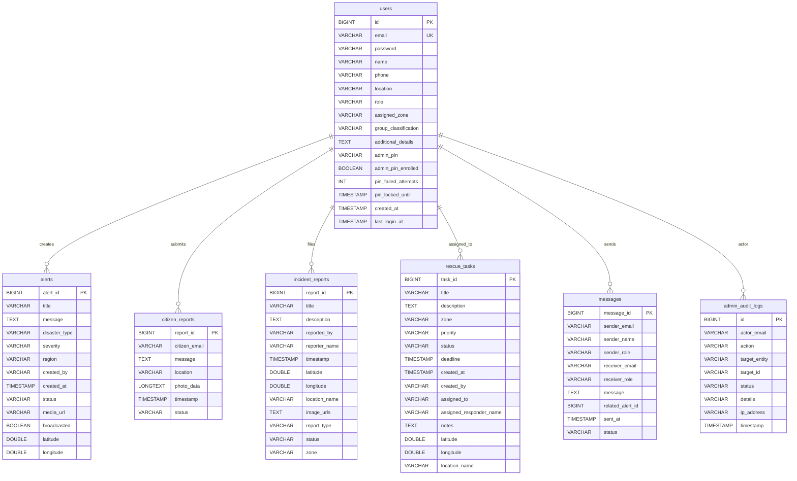

# Database Schema Documentation

## 1. Relational Entity-Relationship Diagram

---

## 2. Table Specifications & Indexes

### Table: `users`
- Stores registered Citizens, Emergency Responders, and Administrators.
- **Primary Key:** `id` (BIGINT AUTO_INCREMENT)
- **Unique Key:** `email` (VARCHAR 255)
- **Indexes:**
  - `idx_email (email)`
  - `idx_role (role)`
  - `idx_role_assignedZone (role, assigned_zone)`

### Table: `alerts`
- Stores administrative disaster alerts broadcasted to citizens and responders.
- **Primary Key:** `alert_id` (BIGINT AUTO_INCREMENT)
- **Indexes:**
  - `idx_region (region)`
  - `idx_status (status)`
  - `idx_created_at (created_at)`

### Table: `citizen_reports`
- Stores live emergency reports submitted by citizens, including Base64 camera photo evidence.
- **Primary Key:** `report_id` (BIGINT AUTO_INCREMENT)
- **Indexes:**
  - `idx_report_citizen_email (citizen_email)`
  - `idx_report_status (status)`
  - `idx_report_timestamp (timestamp)`

### Table: `rescue_tasks`
- Stores dispatched rescue operations assigned to emergency responders.
- **Primary Key:** `task_id` (BIGINT AUTO_INCREMENT)
- **Indexes:**
  - `idx_assignedTo (assigned_to)`
  - `idx_zone (zone)`
  - `idx_status (status)`
  - `idx_assignedTo_status (assigned_to, status)`
  - `idx_zone_status (zone, status)`

### Table: `admin_audit_logs`
- Immutable security log for administrative Step-Up PIN events and privileged actions.
- **Primary Key:** `id` (BIGINT AUTO_INCREMENT)
- **Indexes:**
  - `idx_audit_actor (actor_email)`
  - `idx_audit_action (action)`
  - `idx_audit_timestamp (timestamp)`

