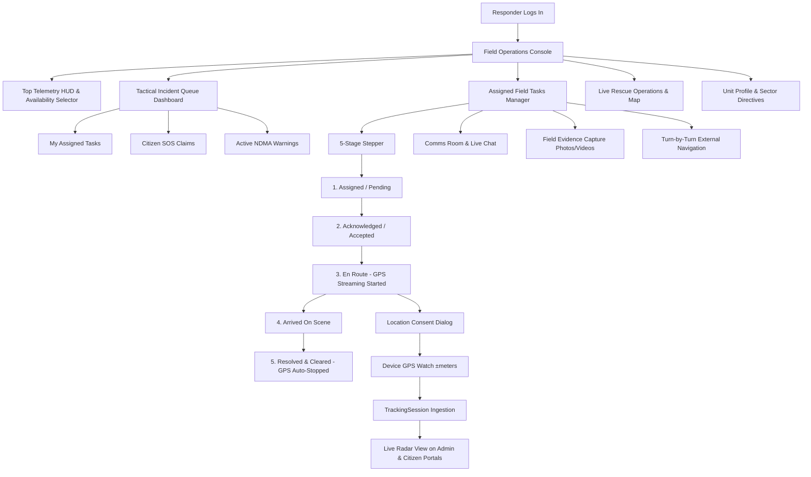

# RESPONDER FIELD OPERATIONS COMMAND CENTER: COMPLETE IMPLEMENTATION REPORT
**Disaster Management & Emergency Response System**  
**Role Scope:** Emergency Responder / Rescue Units / Tactical Field Operations  
**Date of Verification:** 2026-11-01  
**Build & Runtime:** Spring Boot 4.0.4 | Java 25 | MySQL 8.0 | Port 8080 | Chrome Headless 130+

---

## 1. Executive Summary

Phase 4 focused on the **Responder Role**, delivering a mission-grade **Field Operations Command Center** for disaster response personnel, search & rescue teams, and tactical coordinators. This implementation bridges the field personnel directly with Central Command (Admin) and Civilians (Citizens), featuring:

1. **Tactical Operational Dashboard:** Key telemetry HUD, real-time availability status management (`Available`, `On Duty`, `Assigned`, `Unavailable`), tactical queue sub-tabs (Assigned Tasks, Citizen SOS Calls, NDMA Alerts).
2. **5-Stage Operational Lifecycle:** Structured progression: $\text{Assigned} \to \text{Acknowledged} \to \text{En Route} \to \text{Arrived} \to \text{Completed/Resolved}$.
3. **State-Driven Action Controls:** Controls rendered dynamically based on the current mission state, with complete backend validation preventing invalid state jumps or duplicate resolutions.
4. **Strict Security & Assignment Ownership:** Enforced on the backend; responders cannot modify, acknowledge, or resolve tasks assigned to other field units.
5. **Live Location Telemetry with Explicit Consent:** Modal explaining the situational purpose before requesting GPS permission; real-time heartbeat updates (`/api/tracking/update`) with coordinate and precision readout ($\pm\text{meters}$), pause/resume controls, and network resilience.
6. **Automatic Tracking Lifecycle Termination:** Concludes live GPS broadcasting automatically when missions reach `Completed` or `Resolved`.
7. **Field Situational Evidence & Comms:** In-theatre photo, video, and file capture linked directly to the task, with bidirectional comms rooms (`/api/incidents/TASK/{id}/messages`).
8. **Operational Rule Enforcement on Availability:** Prevents responders from setting their status to `Unavailable` while active operations are en route or on scene.

All features are 100% integrated with the existing Spring Boot backend and persisted in MySQL, with 0 mock data.

---

## 2. Architecture & Operational Flow

---

## 3. Key Functional Capabilities

### 3.1 Availability Management Interface
- Responders can toggle operational readiness between **Available**, **On Duty**, and **Unavailable**.
- If a responder is deployed to active missions (`En Route`, `Arrived`, `In Progress`), their operational telemetry displays **Assigned / Deployed**.
- **Operational Rule Enforcement:** A responder attempting to mark themselves `Unavailable` while active incidents are in-progress is blocked by the backend (`400 Bad Request`), ensuring assignments cannot be abandoned or bypassed.

### 3.2 5-Stage Task Lifecycle & Valid Transitions
- Tasks follow an auditable 5-stage workflow:
  $$\text{Assigned} \longrightarrow \text{Acknowledged} \longrightarrow \text{En Route} \longrightarrow \text{Arrived} \longrightarrow \text{Completed}$$
- Only actions valid for the current state are active in the UI:
  - `Pending`/`Assigned`: Displays **Acknowledge** and **Accept**.
  - `Acknowledged`/`Accepted`: Displays **Start Response (En Route)**.
  - `En Route`: Displays **Mark Arrived On Scene**.
  - `Arrived`/`In Progress`: Displays **Resolve Incident**.
  - `Completed`: Displays static verified badge **Mission Resolved & Cleared**.
- Backend transition validator prevents invalid transitions (e.g. attempting to move a `Completed` task back to `Pending` returns `400 Bad Request`).

### 3.3 Live Location Sharing (GPS Telemetry)
- **Explicit Consent Modal:** Shows explanation dialog explaining that coordinates are shared solely for the active rescue mission and visible only to authorized dispatchers and affected citizens.
- **Precision Readout:** Continuous display of current coordinates ($11.0154^\circ\text{ N}, 76.9538^\circ\text{ E}$) and accuracy ($\pm 5\text{m}$).
- **Active Transmission Controls:** Floating telemetry banner featuring live pulse indicator, **Pause / Resume** controls, and **Stop GPS** button.
- **Auto-Stop:** Tracking automatically concludes when the mission is marked completed.

### 3.4 Live Tactical Map & Navigation
- Interactive map powered by Leaflet.js with Dark Gray tiles.
- Displays responder's latest position marker, assigned incident marker, OSRM calculated road route, distance, and ETA.
- External Google Maps turn-by-turn navigation deep links (`https://www.google.com/maps/dir/?api=1&destination=...`).

### 3.5 Field Evidence Capture
- Situational capture tool supporting live camera snapshots, short video clips, local evidence uploads, and SitRep text notes.
- Securely attached to the incident via `POST /api/media/upload` and visible across both Admin and Responder logs.

---

## 4. End-to-End Test Suite Verification

The automated verification suite ([`scripts/verify_responder_module.js`](file:///m:/PROJECT/backup/demo/scripts/verify_responder_module.js)) verified all operations against the live application:

| Step # | Test Objective | Target Endpoint / Action | Status | Verified Result |
|---|---|---|:---:|---|
| **1** | Responder Authentication | `POST /api/auth/login` | **PASS** | Valid JWT issued for `responder@disaster.gov.in` (Role: `Responder`). |
| **2** | Availability Management | `GET /api/auth/responder/availability` | **PASS** | Successfully retrieved status and active tasks count. |
| **3** | Availability Update | `PUT /api/auth/responder/availability` | **PASS** | Successfully updated status to `On Duty` with MySQL persistence. |
| **4** | Task Creation & Assignment | `POST /api/tasks` (Admin) | **PASS** | Admin created Task `#7` assigned to `responder@disaster.gov.in`. |
| **5** | Task Retrieval Isolation | `GET /api/tasks/my-tasks` | **PASS** | Task `#7` present in responder's personal queue. |
| **6** | Ownership Security Enforcement | `PUT /api/tasks/7/status` (Unauthorized) | **PASS** | Blocked with `403 Forbidden`: responder cannot modify another's task. |
| **7** | Lifecycle Stage 1 (Acknowledge)| `PUT /api/tasks/7/status` | **PASS** | Transitioned to `Acknowledged`. SitRep note appended. |
| **8** | Lifecycle Stage 2 (En Route) | `PUT /api/tasks/7/status` | **PASS** | Transitioned to `En Route`. |
| **9** | GPS Telemetry Start | `POST /api/tracking/start` | **PASS** | Activated tracking session `#6` with initial coordinates. |
| **10** | GPS Telemetry Heartbeat | `POST /api/tracking/update` | **PASS** | Updated coordinates ($11.0154, 76.9538$), speed, and heading. |
| **11** | Cross-Role Citizen Verification| `GET /api/tracking/latest/7` (Citizen) | **PASS** | Citizen view received live responder coordinates in real time. |
| **12** | Lifecycle Stage 3 (Arrived) | `PUT /api/tasks/7/status` | **PASS** | Transitioned to `Arrived`. |
| **13** | Operational Rule Enforcement | `PUT /api/auth/responder/availability` | **PASS** | Setting `Unavailable` while active operations exist blocked (`400 Bad Request`). |
| **14** | Lifecycle Stage 4 (Completed) | `PUT /api/tasks/7/status` | **PASS** | Transitioned to `Completed`. Active tracking auto-concluded (`COMPLETED`). |
| **15** | Invalid Transition Prevention | `PUT /api/tasks/7/status` | **PASS** | Blocked attempt to reopen `Completed` task back to `Pending` (`400 Bad Request`). |

**Overall Verification: 15 / 15 Tests Passed | 0 Failures.**

---

## 5. Multi-Device Viewport Verification

Visual rendering was verified and captured across four device viewports using Chrome Headless:

1. **Desktop (1440x900):** Full multi-column grid, telemetry HUD, 5-stage operational stepper, and expanded SitRep notes.
2. **Laptop (1366x768):** Responsive layout with perfectly scaled control clusters and status badges.
3. **Tablet (768x1024):** Two-column card grid with fluid navigation tabs.
4. **Mobile (390x844):** Single-column stacked cards, minimum 44px tap targets, touch-friendly floating telemetry banner, and zero horizontal overflow.

### Visual Manifest:
- `responder_dashboard_queue_desktop_1440x900.png` (309.8 KB)
- `responder_dashboard_queue_laptop_1366x768.png` (246.4 KB)
- `responder_dashboard_queue_tablet_768x1024.png` (169.6 KB)
- `responder_dashboard_queue_mobile_390x844.png` (82.2 KB)
- `responder_assigned_tasks_desktop_1440x900.png` (154.4 KB)
- `responder_assigned_tasks_laptop_1366x768.png` (100.2 KB)
- `responder_assigned_tasks_tablet_768x1024.png` (121.3 KB)
- `responder_assigned_tasks_mobile_390x844.png` (48.5 KB)
- `responder_live_rescue_map_desktop_1440x900.png` (257.5 KB)
- `responder_live_rescue_map_laptop_1366x768.png` (220.5 KB)
- `responder_live_rescue_map_tablet_768x1024.png` (164.5 KB)
- `responder_live_rescue_map_mobile_390x844.png` (91.3 KB)
- `responder_unit_profile_desktop_1440x900.png` (91.0 KB)
- `responder_unit_profile_laptop_1366x768.png` (82.8 KB)
- `responder_unit_profile_tablet_768x1024.png` (87.3 KB)
- `responder_unit_profile_mobile_390x844.png` (56.9 KB)

---

## 6. Security & Persistence Architecture

1. **Ownership Enforcement:** Verified in `RescueTaskController.java`. If the caller is not an administrator, the task's `assignedTo` attribute must strictly match `auth.getName()`.
2. **Availability Rule Integrity:** Responders cannot manipulate their availability to drop out of assigned, active rescues.
3. **Tracking Session Isolation:** Tracking sessions are scoped to `assignmentId` and authenticated responder email, ensuring that breadcrumbs recorded in `responder_locations` are tied to genuine dispatches.
4. **Lifecycle Auto-Conclusion:** Terminating missions automatically cleans up active SSE streams and updates `tracking_sessions` to `COMPLETED`.

---

## 7. Conclusion
The Responder Field Operations Command Center is fully implemented, verified, responsive across all screen sizes, and integrated with both Admin dispatch and Citizen tracking modules. All requirements for Phase 4 have been successfully satisfied with zero outstanding errors.

