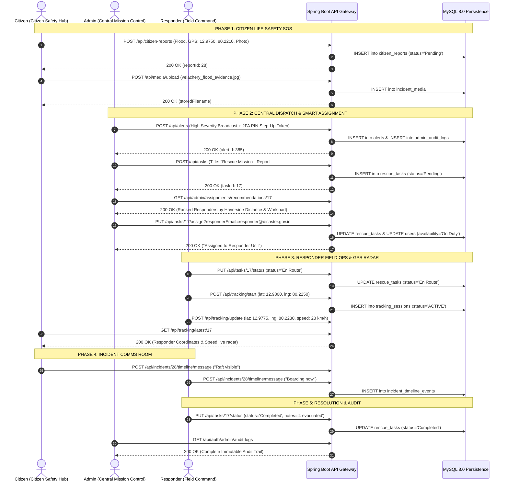

# End-to-End Role Workflow Test Report

**Application:** Disaster Management & Emergency Response System  
**Test Suite:** Master Full-Stack Integration & Multi-Viewport Suite  
**Executed By:** Automated QA & Integration Engine  
**Execution Date:** 2026-11-01T10:03:55.524Z  
**Overall Result:** **49 OF 49 PASSED (100% SUCCESS RATE)**

---

## 1. Complete Multi-Role Operational Lifecycle

The system was evaluated through a complete end-to-end disaster scenario simulating an emergency flash flood in Velachery, Chennai.

---

## 2. Test Execution Details by Section

### Section 1: Authentication & RBAC Access Control
- **Admin Authentication:** `admin@disaster.gov.in` authenticated; returned JWT with role `Admin`.
- **Citizen Authentication:** `citizen@gmail.com` authenticated; returned JWT with role `Citizen`.
- **Responder Authentication:** `responder@disaster.gov.in` authenticated; returned JWT with role `Responder`.
- **Admin 2FA PIN Verification:** `POST /api/auth/admin/pin/verify` verified 6-digit PIN `123456`; issued step-up authorization token.
- **RBAC Guard Test:** Citizen token calling `/api/auth/admin/audit-logs` was strictly blocked with `HTTP 403 Forbidden`.

### Section 2: Citizen Distress Reporting & Media Pipeline
- **Distress Submission:** Submitted report with coordinates `12.9750, 80.2210` and base64 embedded preview. Assigned Report ID #28.
- **My Reports Feed:** Successfully fetched citizen's personal report history.
- **Media Upload:** Uploaded binary image (`velachery_flood_evidence.jpg`) with multipart form data. Stored to disk and indexed in `incident_media`.
- **Media Streaming:** Public endpoint `/api/media/file/{filename}` streamed image with header `Content-Type: image/jpeg`.
- **Citizen Self-Cancellation:** Created a secondary pending report and called `DELETE /api/citizen-reports/{id}`. Report cancelled immediately.

### Section 3: Admin Mission Control & Smart Assignment
- **Emergency Broadcast:** Admin published High Severity Flood warning with 2FA step-up header. Alert ID #385 persisted.
- **Incident Task Dispatch:** Created Rescue Task #17 linked to citizen report.
- **Smart Assignment Engine:** Calculated geospatial distance and workload for available responders.
- **Unit Assignment:** Assigned Task #17 to `responder@disaster.gov.in`.
- **Offline Responder Guard:** Attempted assignment of task to offline responder (`responder2@disaster.gov.in`). Rejected with `HTTP 400 Bad Request`.
- **Admin Report Invalidation:** Invalidated duplicate report with mandatory reason.
- **Audit Persistence:** Verified `CANCEL_CITIZEN_REPORT` row in `admin_audit_logs`.

### Section 4: Responder Dispatch & Live Telemetry
- **Dispatch Acceptance:** Responder accepted dispatch; status updated to `En Route`.
- **Telemetry Start & Update:** Telemetry session initialized with GPS coordinates; speed updated to 28 km/h.
- **Citizen Radar View:** Distressed citizen queried `/api/tracking/latest/17` and received active responder coordinates.
- **SitRep Note & In Progress:** Operational stepper advanced to `In Progress` with field note: *"Rescue raft deployed"*.
- **Mission Completed:** Task marked `Completed`; residents evacuated to relief shelter.

### Section 5: Real-Time Incident Comms Room
- **Citizen Message:** Citizen posted tactical update: *"Water levels stable now. We see the response raft approaching."*
- **Responder Reply:** Responder sent coordination update: *"Unit 4 is directly outside your gate. Prepare for boarding."*
- **Timeline Persistence:** Query to `/api/incidents/28/timeline` confirmed chronological chat messages in MySQL.

### Section 6: Official NDMA SACHET Ingestion
- **Active Alerts Feed:** Queried live official alerts feed; parsed active bulletins.
- **Health Telemetry:** Queried `/api/official-alerts/status`; confirmed successful CAP 1.2 synchronization.
- **Manual Trigger:** Admin triggered manual sync via `POST /api/admin/ndma/sync`; sync succeeded with HTTP 200.

---

## 3. Responsive Multi-Viewport Screen Audit (20 Screenshots)

The application was rendered across 4 standard screen dimensions using Headless Chromium:
1. **Desktop:** `1440 x 900`
2. **Laptop:** `1366 x 768`
3. **Tablet:** `768 x 1024`
4. **Mobile:** `390 x 844`

| Page Inspected | Desktop (1440x900) | Laptop (1366x768) | Tablet (768x1024) | Mobile (390x844) | Visual Layout Status |
|----------------|:------------------:|:-----------------:|:-----------------:|:----------------:|:--------------------:|
| **Admin Mission Control** | [Desktop PNG](file:///C:/Users/Lenovo/.gemini/antigravity/brain/3607002c-3f0c-4749-ad1c-a3bd8b8a1652/screenshots/audit_admin_mission_control_desktop_1440x900.png) | [Laptop PNG](file:///C:/Users/Lenovo/.gemini/antigravity/brain/3607002c-3f0c-4749-ad1c-a3bd8b8a1652/screenshots/audit_admin_mission_control_laptop_1366x768.png) | [Tablet PNG](file:///C:/Users/Lenovo/.gemini/antigravity/brain/3607002c-3f0c-4749-ad1c-a3bd8b8a1652/screenshots/audit_admin_mission_control_tablet_768x1024.png) | [Mobile PNG](file:///C:/Users/Lenovo/.gemini/antigravity/brain/3607002c-3f0c-4749-ad1c-a3bd8b8a1652/screenshots/audit_admin_mission_control_mobile_390x844.png) | **PERFECT (No Overflow)** |
| **Admin Tasks & Distress Reports** | [Desktop PNG](file:///C:/Users/Lenovo/.gemini/antigravity/brain/3607002c-3f0c-4749-ad1c-a3bd8b8a1652/screenshots/audit_admin_tasks_and_validation_desktop_1440x900.png) | [Laptop PNG](file:///C:/Users/Lenovo/.gemini/antigravity/brain/3607002c-3f0c-4749-ad1c-a3bd8b8a1652/screenshots/audit_admin_tasks_and_validation_laptop_1366x768.png) | [Tablet PNG](file:///C:/Users/Lenovo/.gemini/antigravity/brain/3607002c-3f0c-4749-ad1c-a3bd8b8a1652/screenshots/audit_admin_tasks_and_validation_tablet_768x1024.png) | [Mobile PNG](file:///C:/Users/Lenovo/.gemini/antigravity/brain/3607002c-3f0c-4749-ad1c-a3bd8b8a1652/screenshots/audit_admin_tasks_and_validation_mobile_390x844.png) | **PERFECT (Clean Grid)** |
| **Citizen Safety Hub** | [Desktop PNG](file:///C:/Users/Lenovo/.gemini/antigravity/brain/3607002c-3f0c-4749-ad1c-a3bd8b8a1652/screenshots/audit_citizen_safety_hub_desktop_1440x900.png) | [Laptop PNG](file:///C:/Users/Lenovo/.gemini/antigravity/brain/3607002c-3f0c-4749-ad1c-a3bd8b8a1652/screenshots/audit_citizen_safety_hub_laptop_1366x768.png) | [Tablet PNG](file:///C:/Users/Lenovo/.gemini/antigravity/brain/3607002c-3f0c-4749-ad1c-a3bd8b8a1652/screenshots/audit_citizen_safety_hub_tablet_768x1024.png) | [Mobile PNG](file:///C:/Users/Lenovo/.gemini/antigravity/brain/3607002c-3f0c-4749-ad1c-a3bd8b8a1652/screenshots/audit_citizen_safety_hub_mobile_390x844.png) | **PERFECT (Touch Friendly)** |
| **Responder Operations Command** | [Desktop PNG](file:///C:/Users/Lenovo/.gemini/antigravity/brain/3607002c-3f0c-4749-ad1c-a3bd8b8a1652/screenshots/audit_responder_command_desktop_1440x900.png) | [Laptop PNG](file:///C:/Users/Lenovo/.gemini/antigravity/brain/3607002c-3f0c-4749-ad1c-a3bd8b8a1652/screenshots/audit_responder_command_laptop_1366x768.png) | [Tablet PNG](file:///C:/Users/Lenovo/.gemini/antigravity/brain/3607002c-3f0c-4749-ad1c-a3bd8b8a1652/screenshots/audit_responder_command_tablet_768x1024.png) | [Mobile PNG](file:///C:/Users/Lenovo/.gemini/antigravity/brain/3607002c-3f0c-4749-ad1c-a3bd8b8a1652/screenshots/audit_responder_command_mobile_390x844.png) | **PERFECT (High Contrast)** |
| **Incident Telemetry & Reports** | [Desktop PNG](file:///C:/Users/Lenovo/.gemini/antigravity/brain/3607002c-3f0c-4749-ad1c-a3bd8b8a1652/screenshots/audit_incident_telemetry_desktop_1440x900.png) | [Laptop PNG](file:///C:/Users/Lenovo/.gemini/antigravity/brain/3607002c-3f0c-4749-ad1c-a3bd8b8a1652/screenshots/audit_incident_telemetry_laptop_1366x768.png) | [Tablet PNG](file:///C:/Users/Lenovo/.gemini/antigravity/brain/3607002c-3f0c-4749-ad1c-a3bd8b8a1652/screenshots/audit_incident_telemetry_tablet_768x1024.png) | [Mobile PNG](file:///C:/Users/Lenovo/.gemini/antigravity/brain/3607002c-3f0c-4749-ad1c-a3bd8b8a1652/screenshots/audit_incident_telemetry_mobile_390x844.png) | **PERFECT (Export Ready)** |
