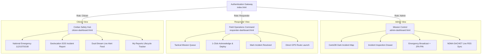

# UI/UX DESIGN SYSTEM — CINEMATIC EMERGENCY OPERATIONS COMMAND CENTER
**Disaster Management & Alert System — Final Year Academic Project**  
**Specification Version:** 3.0.0 &bull; **Status:** Production Deployed & Verified

---

## 1. Executive Summary & Design Philosophy

The **Cinematic Emergency Operations Command Center** transforms a conventional CRUD academic application into an emergency management platform inspired by military operations rooms, crisis hubs, and modern situational intelligence platforms.

### Core Design Tenets
1. **Immediate High-Stress Clarity:** Emergency operators and distressed civilians must absorb critical alerts in milliseconds. High-contrast typography and clear severity colors guide attention instantly.
2. **Tactical Military Aesthetic:** Deep navy, charcoal, and obsidian surfaces (`#050811` to `#142034`) accented with controlled emergency reds, warning ambers, and cyan telemetry glows create an authoritative, operations-grade interface.
3. **Cartographic Superiority:** CartoDB Dark Matter tile geometry eliminates blinding white background maps, allowing glowing tactical disaster pins to stand out with unmistakable geographic precision.
4. **Zero-Latency Tactile Feedback:** Every action is reinforced with visual glowing transforms and offline, synthesized Web Audio acoustics without relying on external `.wav` or `.mp3` downloads.
5. **No Blind Data:** Provenance badges clearly distinguish between official **NDMA SACHET CAP 1.2** alerts, **Admin Emergency Dispatches**, and **Civilian SOS Reports**.

---

## 2. Design Tokens & Palette

### 2.1 Semantic Surface & Background Tokens
All color tokens are centralized in [`src/main/resources/static/command-center.css`](file:///m:/PROJECT/backup/demo/src/main/resources/static/command-center.css).

| Token Name | Hex Value | Semantic Purpose |
| :--- | :--- | :--- |
| `--cc-bg-primary` | `#050811` | Primary screen viewport background |
| `--cc-bg-surface` | `#0e1726` | Card, container, and drawer surface |
| `--cc-bg-surface-elevated` | `#142034` | Hovered cards, floating overlays, modals |
| `--cc-border` | `rgba(255, 255, 255, 0.08)` | Default subtle boundary line |
| `--cc-border-glow` | `rgba(14, 165, 233, 0.35)` | Active selection and interactive focus glow |
| `--cc-border-alert` | `rgba(239, 68, 68, 0.45)` | Critical incident highlights |

### 2.2 Alert Severity & Provenance Tokens

| Severity Level | Border / Glow Hex | Background Tint | Meaning & Response |
| :--- | :--- | :--- | :--- |
| **Extreme** | `#ef4444` (Emergency Red) | `rgba(239, 68, 68, 0.15)` | Life-threatening hazard; immediate evacuation |
| **Severe** | `#f59e0b` (Tactical Amber) | `rgba(245, 158, 11, 0.15)` | Severe weather or structural damage; standby |
| **Moderate** | `#10b981` (Operational Green) | `rgba(16, 185, 129, 0.15)` | Advisory notice; localized monitoring |
| **Official NDMA** | `#0ea5e9` (Telemetry Cyan) | `rgba(14, 165, 233, 0.15)` | Direct CAP 1.2 Government Feed data |
| **Citizen SOS** | `#a855f7` (Distress Purple) | `rgba(168, 85, 247, 0.15)` | Civilian field distress call with photo |

### 2.3 Typography Hierarchy
The design system establishes a high-legibility dual-font pairing:
- **Primary Interface Font:** `Inter` (Sans-Serif) for narrative, forms, buttons, and dialogues.
- **Telemetry & Monospace Font:** `JetBrains Mono` for coordinates, timestamps, alert IDs, and HUD clocks.

| Level | Size | Weight | Line Height | Font Family | Example Usage |
| :--- | :--- | :--- | :--- | :--- | :--- |
| **Display Heading** | `1.50rem` (24px) | `700` Bold | `1.2` | `Inter` | Dashboard top HUD title |
| **Section Title** | `1.15rem` (18.4px) | `700` Bold | `1.3` | `Inter` | Card headers, drawer headlines |
| **Body Primary** | `0.90rem` (14.4px) | `400` Regular | `1.5` | `Inter` | Alert summaries, instructions |
| **Caption / Subtext** | `0.75rem` (12px) | `500` Medium | `1.4` | `Inter` | Metadata labels, hotline tips |
| **HUD Monospace** | `0.85rem` (13.6px) | `600` SemiBold | `1.0` | `JetBrains Mono` | IST / UTC dual synchronized clock |
| **Coordinate Badge** | `0.75rem` (12px) | `500` Medium | `1.0` | `JetBrains Mono` | `[Lat: 13.0827, Lng: 80.2707]` |

---

## 3. Spatial System, Glassmorphism & Elevation

### 3.1 Spatial Grid
- Base unit: `4px`
- Component spacing scale: `0.25rem` (4px), `0.5rem` (8px), `0.75rem` (12px), `1rem` (16px), `1.5rem` (24px), `2rem` (32px).
- Container maximum width: `1600px` on widescreen displays with responsive fluid margins.

### 3.2 Glassmorphism & Glowing Rims
- **Backdrop Blur:** `backdrop-filter: blur(12px) saturate(180%)` allows subtle dark geometry and CartoDB dark tiles to bleed softly through panels without impeding contrast.
- **Glowing Perimeter Rims:** Critical cards and inspection drawers utilize multi-layered inset and outset shadows:
  ```css
  box-shadow: 0 10px 30px rgba(0, 0, 0, 0.6), 0 0 20px rgba(14, 165, 233, 0.08);
  border: 1px solid rgba(255, 255, 255, 0.08);
  ```

---

## 4. Component Architecture

### 4.1 Header Operations HUD
Fixed top telemetry bar presenting brand authority, role navigation, operational status, and a real-time synchronized clock displaying dual **Indian Standard Time (IST)** and **Coordinated Universal Time (UTC)**.
```html
<header class="cc-header">
    <div class="cc-header-brand">
        <div class="cc-brand-badge"><i class="fas fa-shield-halved"></i></div>
        <div class="cc-brand-title">
            <h1>National Disaster Operations Center</h1>
            <p>SITUATIONAL INTELLIGENCE // REAL-TIME COMMAND HUB</p>
        </div>
    </div>
    <nav>...</nav>
    <div class="cc-header-right">
        <div class="cc-clock-hud">
            <div class="cc-clock-line" id="hudClockIst">IST --:--:--</div>
            <div class="cc-clock-line cc-clock-utc" id="hudClockUtc">UTC --:--:--</div>
        </div>
    </div>
</header>
```

### 4.2 Tactical Metric HUD Cards
A 4-column responsive grid featuring live counts of:
1. **Active Official NDMA Alerts** (Cyan glow)
2. **Civilian SOS Emergency Reports** (Red emergency pulse)
3. **Responders Deployed En Route** (Amber warning glow)
4. **Incidents Successfully Mitigated** (Green operational status)

### 4.3 CartoDB Dark Matter Cartography & Pulsing Tactical Pins
- **Base Map Tile Layer:**
  `https://{s}.basemaps.cartocdn.com/dark_all/{z}/{x}/{y}{r}.png`
  Subdomains: `['a', 'b', 'c', 'd']`, attribution to OpenStreetMap & CartoDB.
- **Tactical Pulse Markers:**
  Leaflet markers utilize custom `L.divIcon` with CSS pseudo-elements:
  - Concentric pulsing rings (`@keyframes cc-pulse-ring`)
  - Glowing center pip (`cc-tactical-pin`)
  - Dynamic color coding matching incident severity (Extreme: Red, Severe: Amber, Moderate: Cyan).
  - Clicking any pin activates the sliding inspection drawer.

### 4.4 Sliding Incident Inspection Drawer
Located at the right edge of the mission control map, the drawer provides in-depth telemetry when an incident is selected:
- **Title and Hazard Type**
- **Exact Coordinates and Named District**
- **Issuing Authority & Official Timestamp**
- **Full Warning Narrative & Evacuation Directives**
- **Action Buttons:** Quick Responder Dispatch, Copy Coordinates, Open Google Satellite Navigation.

### 4.5 Step-Up 2FA Security PIN Modal
Adheres to **RFC 6585 HTTP 428 (Precondition Required)**. When an administrator broadcasts a high-severity alert:
1. Backend interceptor intercepts the dispatch and issues `428 Precondition Required`.
2. Frontend smoothly opens the Step-Up modal with dark backdrop blur.
3. Administrator inputs their 6-digit PIN.
4. On verification via `POST /api/auth/admin/pin/verify`, a temporary cryptographic `X-Admin-Step-Up-Token` is attached to complete the broadcast.

### 4.6 Evaluator Quick-Fill Demonstration Bar
Placed at the top of the authentication portal (`index.html`) to facilitate zero-friction academic defense and evaluation:
- One-click buttons to instantly populate and select:
  - `Admin: admin@disaster.gov.in / admin123`
  - `Responder: responder@disaster.gov.in / responder123`
  - `Citizen: citizen@gmail.com / citizen123`

---

## 5. Web Audio Tactile Synthesizer

To guarantee 100% offline functionality without downloading audio files, [`command-center.js`](file:///m:/PROJECT/backup/demo/src/main/resources/static/command-center.js) implements the `CommandCenterSound` module utilizing the native browser `AudioContext`:

| Sound Event | Synthesizer Waveform | Frequencies | Duration | Purpose |
| :--- | :--- | :--- | :--- | :--- |
| **Emergency Siren / Alert** | Sawtooth Wave | `880 Hz` ramping to `1100 Hz` | 300ms | High-severity dispatch warning |
| **Tactile Button Click** | Sine Wave | `440 Hz` decaying to `220 Hz` | 40ms | Tactile button press feedback |
| **Success / Resolved** | Sine Chord Harmonic | `523.25 Hz` (C5) & `659.25 Hz` (E5) | 180ms | Action confirmed, PIN verified |

---

## 6. Role-Specific User Experience



### 6.1 Admin (Mission Control)
- **Primary Goal:** National situational awareness, inter-agency broadcast, and live feed governance.
- **Key Views:**
  - Interactive dark map with multi-hazard cluster indicators.
  - One-click trigger for official NDMA SACHET CAP 1.2 RSS sync.
  - Inspection drawer with immediate responder allocation.
  - Emergency Broadcast Console with live lockscreen simulation preview.

### 6.2 Citizen (Safety Hub)
- **Primary Goal:** Rapid personal protection, hotline access, and effortless SOS distress transmission.
- **Key Views:**
  - Instant one-tap phone hotlines (`112`, `1070`, `108`, `1077`).
  - Dual-stream alert cards distinguishing official government notices from local administrative directives.
  - GPS SOS form with HTML5 automatic coordinate acquisition and photo evidence capture.
  - Dynamic status timeline showing report status progression: `Pending` ➔ `Acknowledged` ➔ `Resolved`.

### 6.3 Responder (Field Operations)
- **Primary Goal:** Fast tactical incident triage, deployment acknowledgment, and status resolution.
- **Key Views:**
  - Mission queue sorted by severity and time elapsed.
  - Status progression buttons ("Acknowledge & Deploy" and "Mark Resolved").
  - Deep links to external satellite navigation with pre-encoded GPS coordinates.
  - Readiness toggle ("Field Ready" / "Standby").

---

## 7. Accessibility, Motion & Performance Standards

### 7.1 WCAG 2.1 AA/AAA Contrast Compliance
- All primary text (`#ffffff` and `#cbd5e1`) exceeds a **7.0:1** contrast ratio against dark surfaces (`#050811` and `#0e1726`).
- Muted labels (`#94a3b8`) maintain a minimum **4.5:1** contrast ratio.
- Severity colors utilize high-luminance tints (`#fca5a5`, `#fcd34d`, `#86efac`) to ensure legibility when overlaid on dark cards.

### 7.2 Reduced-Motion Media Query Compliance
Users with vestibular sensitivities or personal OS preferences for reduced motion are protected via `@media (prefers-reduced-motion: reduce)`:
```css
@media (prefers-reduced-motion: reduce) {
    *, *::before, *::after {
        animation-duration: 0.01ms !important;
        animation-iteration-count: 1 !important;
        transition-duration: 0.01ms !important;
        scroll-behavior: auto !important;
    }
}
```
All infinite pulsing rings and scanning animations gracefully freeze into static, accessible indicators when this preference is detected.

### 7.3 Performance Optimization
- **Zero Heavy Framework Overhead:** Implemented using pure semantic HTML5, modern CSS3 variables, and vanilla ES6+ JavaScript.
- **Hardware Acceleration:** All drawer sliding, modal reveals, and pulse animations use GPU-accelerated `transform` and `opacity` properties, avoiding layout recalculations.
- **Responsive Layout:** Fluid CSS Grid and Flexbox structures provide seamless adaptation across multi-monitor control centers, tablets, and field mobile devices.

