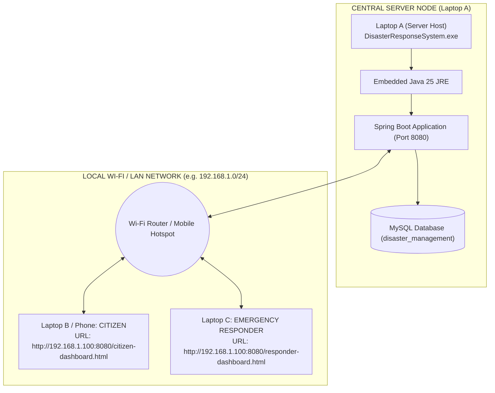

# DISASTER RESPONSE SYSTEM — SAME-WIFI / LAN MULTI-DEVICE SETUP GUIDE

**Architecture:** Centralized Server Node + Multi-Client Private Network  
**Target Scenario:** College Project Review, Live Demonstration & Tactical Operations  



---

## 1. Step-by-Step Multi-Laptop Setup Procedure

### Step 1: Connect All Devices to the Same Local Network
- Connect **Laptop A (Server)**, **Laptop B (Citizen)**, and **Laptop C (Responder)** to the same Wi-Fi router or phone mobile hotspot.
- Ensure that the network type in Windows is set to **Private Network** (not Public).

### Step 2: Open Windows Firewall Port 8080 on Laptop A
To allow other laptops to communicate with the Spring Boot server on port 8080:
1. In the **DisasterResponseSystem Console**, click the **Firewall Port** button.
2. Accept the Windows User Account Control (UAC) prompt.
3. *Alternative:* Right-click `setup-firewall.bat` in the application directory and select **Run as Administrator**.

> **Security Note:** This only creates a local inbound rule for TCP port 8080 on private/domain profiles. It does not disable the Windows firewall or expose MySQL port 3306.

### Optional: HTTPS Mode for Live Camera, Mic & GPS on Other LAN Laptops
Modern browsers (Chrome/Edge) restrict `navigator.mediaDevices.getUserMedia` (camera/mic) and `navigator.geolocation` (GPS) on plain `http://<LAN-IP>:8080` origins. On a friend's laptop, you have two options:
1. **Quick Chrome Dev Flag (No Certificate Needed):** Open `chrome://flags/#unsafely-treat-insecure-origin-as-secure` on the friend's laptop, add `http://<HOST-LAN-IP>:8080`, set to **Enabled**, and relaunch Chrome.
2. **Local HTTPS Certificate (Recommended for Demos):** Generate a self-signed PKCS12 keystore once and pass it in `%LOCALAPPDATA%\DisasterResponseSystem\application-local.properties`:
   ```cmd
   keytool -genkeypair -alias disaster-lan -keyalg RSA -keysize 2048 -storetype PKCS12 -keystore "%LOCALAPPDATA%\DisasterResponseSystem\lan-keystore.p12" -validity 365 -ext "SAN=IP:<HOST-LAN-IP>,DNS:localhost"
   ```
   ```properties
   server.port=8443
   server.ssl.enabled=true
   server.ssl.key-store=file:${LOCALAPPDATA}/DisasterResponseSystem/lan-keystore.p12
   server.ssl.key-store-password=changeit
   server.ssl.key-store-type=PKCS12
   ```

### Step 3: Identify the LAN Access URL
- Look at the green **Local Wi-Fi / LAN Access URL** displayed inside the DisasterResponseSystem Console:
  ```
  http://192.168.x.x:8080
  ```
- Click **Copy LAN URL** to copy it to your clipboard.

### Step 4: Open Portals on Client Laptops

#### On Laptop B (Citizen Role):
1. Open Google Chrome, Edge, or Safari.
2. Navigate to:
   ```
   http://192.168.x.x:8080/citizen-dashboard.html
   ```
   *(Replace `192.168.x.x` with Laptop A's actual IP)*
3. Log in with:
   - **Email:** `citizen@gmail.com`
   - **Password:** `citizen123`
4. Test:
   - Click **Emergency SOS Distress Signal** or submit an incident report.
   - Attach photo/video evidence.
   - Enter the incident comms room.

#### On Laptop C (Responder Role):
1. Open web browser.
2. Navigate to:
   ```
   http://192.168.x.x:8080/responder-dashboard.html
   ```
3. Log in with:
   - **Email:** `responder@disaster.gov.in`
   - **Password:** `responder123`
4. Test:
   - Accept the incident task dispatched by the Admin.
   - Share live tactical GPS location.
   - Update operational status (`En Route` &rarr; `On Scene` &rarr; `Resolved`).

#### On Laptop A (Central Command):
- Monitor everything in real time at:
  ```
  http://localhost:8080/admin-dashboard.html
  ```
- Broadcast emergency alerts to Citizens.
- Watch responder telemetry markers update dynamically on the Leaflet radar map.

---

## 2. Troubleshooting & Diagnostic Checklist

| Symptom | Diagnostic Cause | Solution |
| :--- | :--- | :--- |
| **Client laptop says "Connection Refused / ERR_CONNECTION_TIMED_OUT"** | Windows Firewall is blocking inbound port 8080 on Laptop A. | Click **Firewall Port** in the console or run `setup-firewall.bat` as Administrator. Ensure Wi-Fi network profile is set to **Private**. |
| **Client laptops cannot ping Laptop A** | AP / Client Isolation is enabled on the Wi-Fi router. | Disable "Client Isolation" in router settings, or use a phone Wi-Fi hotspot where devices can talk to each other directly. |
| **IP address changes between sessions** | Wi-Fi router DHCP lease expired. | The launcher automatically detects the new IPv4 address on every start. Simply copy the new LAN URL. |
| **Port 8080 Already in Use** | Another instance or process is using port 8080. | The DisasterResponseSystem Named Mutex prevents duplicate instances. Check Task Manager and terminate any lingering Java process. |

---

## 3. Real-Time End-to-End Verification Matrix

| Flow | Initiating Node | Receiving Node | Verification Method |
| :--- | :--- | :--- | :--- |
| **Emergency SOS Distress** | Laptop B (Citizen) | Laptop A (Admin Radar) | Instant appearance of high-priority pin on Admin tactical map |
| **Task Dispatch** | Laptop A (Admin) | Laptop C (Responder) | Incoming mission card and notification on Responder HUD |
| **Live Responder GPS** | Laptop C (Responder) | Laptop A & B | Real-time coordinate updates on tactical map |
| **Emergency Broadcast** | Laptop A (Admin) | Laptop B (Citizen) | Audible tone and unread alert badge in Citizen Notification Center |
| **Comms Room & Attachments** | Laptop B & C | All three roles | Shared multi-party timeline notes and uploaded media gallery |
